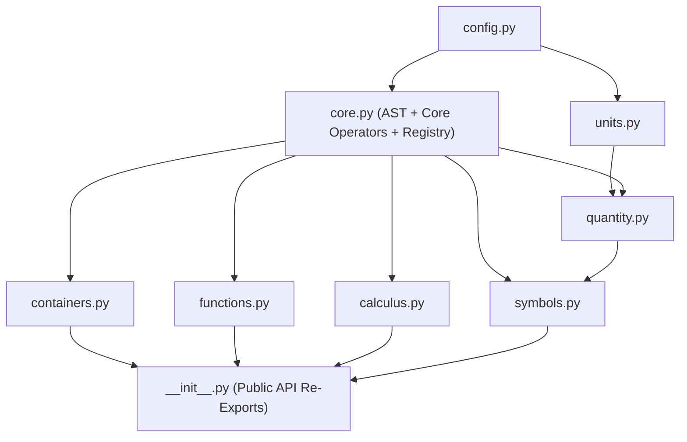

# Pyndoc Refactoring & Engineering Guide: From Prototype to Portfolio Showcase

This guide provides a comprehensive roadmap for testing, modularizing, hardening, and elevating the **Pyndoc** codebase into a production-grade portfolio project for senior software engineering roles.

---

## 1. Pre-Modularization Hardening: Fixing Core Architectural Flaws in `latex.py`

Before splitting `src/pyndoc/latex.py` (~3,950 lines) across multiple files, several foundational flaws in its design must be addressed in place. Resolving them now prevents propagating architectural bugs and circular dependencies into the new package structure.

### 1.1 Automatic Precedence-Based Parenthesization (Fixing `(a + b) * c`) [COMPLETED]

#### The Problem
`_BinaryOperator` defines `self.precedence = 0`, and subclasses assign precedence levels (`Addition` = 1, `Multiplication` = 2, `Power` = 3). However, **this precedence value is never inspected in `__str__` anywhere in the codebase.**
```python
a, b, c = var("a", 1), var("b", 2), var("c", 3)
expr = (a + b) * c
print(expr)  # Output: a + b  c  (Mathematically WRONG: missing grouping brackets!)
```
Currently, Pyndoc forces users to manually insert `tex.bracket(a + b) * c`.

#### The Fix: Precedence Hierarchy & Formatting Rules
1. Define standardized precedence constants:
   | Operator Category | Precedence | Examples |
   | :--- | :---: | :--- |
   | **Comparison** | `0` | `=`, `<`, `>`, `<=`, `>=`, `\approx`, `\equiv` |
   | **Addition / Subtraction** | `10` | `+`, `-` |
   | **Multiplication / Division** | `20` | `*` (implicit `ab`), `@` (explicit `\times`), `/` (`\frac`) |
   | **Unary / Negation** | `30` | `-x`, `+x` |
   | **Power / Index** | `40` | `^`, `_` |
   | **Atomic / Enclosed** | `100` | `Literal`, `Variable`, `Quantity`, `Bracket` |

2. Implement `_format_operand(operand, is_right: bool)` in `_BinaryOperator`:
   * An operand requires parentheses if its precedence is strictly less than the parent operator:
     $$\text{operand.precedence} < \text{self.precedence}$$
   * For non-associative operations (e.g. Subtraction $a - (b - c)$), the right operand also requires parentheses if its precedence is *equal* to the parent operator:
     $$\text{is\_right and operand.precedence} \le \text{self.precedence}$$
   * Fractions (`Division` using `\frac{num}{den}`) visually group operands via braces `{...}{...}`, so their numerator and denominator do not require extra parentheses unless rendered inline.

```python
# Implementation pattern for _BinaryOperator
def _needs_brackets(self, operand: Token, is_right: bool = False) -> bool:
    op_prec = getattr(operand, "precedence", 100)
    if op_prec < self.precedence:
        return True
    if is_right and op_prec == self.precedence and not getattr(self, "is_associative", True):
        return True
    return False

def _format_operand(self, operand: Token, is_right: bool = False) -> str:
    if self._needs_brackets(operand, is_right):
        return f"\\left({operand}\\right)"
    return str(operand)

def __str__(self) -> str:
    left_str = self._format_operand(self.left, is_right=False)
    right_str = self._format_operand(self.right, is_right=True)
    if self.symbol:
        return f"{left_str} {self.symbol} {right_str}"
    return f"{left_str} {right_str}"
```

---

### 1.2 Decoupling the Base `Token` "God Object" (Breaking Circular Dependencies)

#### The Problem
`Token` currently has **60+ convenience methods** (`sin`, `cos`, `tan`, `integral`, `derivative`, `prime`, `abs`, `sqrt`, `cbrt`, etc.) hardcoded directly onto it.
```python
class Token(ABC):
    def sin(self): return Sine(self)
    def integral(self, ...): return Integral(self, ...)
    def derivative(self, ...): return Derivative(self, ...)
```
In a single file, Python resolves these because method execution is deferred until call time. However, when splitting into `core.py`, `calculus.py`, `functions.py`, and `operators/`, `core.py`'s `Token` cannot import from `calculus.py` without creating unresolvable circular import chains.

#### The Fix: Functional Math + Dynamic Extension Binding
1. **Mathematical Functions as Standalone Callables:** Primary mathematical access should follow standard Python and SymPy conventions:
   ```python
   from pyndoc.latex import sin, cos, integral, diff
   expr = sin(x) + integral(y, variable=x)
   ```
2. **Dynamic Method Binding for Backward Compatibility:** To preserve method chaining (`x.sin()`, `x.derivative(...)`) without circular imports, keep `Token` in `core.py` minimal (only core dunder operators `__add__`, `__sub__`, etc.). Attach convenience methods dynamically *after* all classes are defined (in `latex/__init__.py`):
   ```python
   # src/pyndoc/latex/__init__.py
   def _bind_token_methods() -> None:
       """Bind convenience methods to Token after all subclasses are loaded."""
       from .functions import Sine, Cosine, Tangent, NthRoot
       from .calculus import Integral, Derivative
       from .containers import AbsoluteValue

       Token.sin = lambda self: Sine(self)
       Token.cos = lambda self: Cosine(self)
       Token.tan = lambda self: Tangent(self)
       Token.sqrt = lambda self: NthRoot(self, 2)
       Token.abs = lambda self: AbsoluteValue(self)
       Token.integral = lambda self, *args, **kwargs: Integral(self, *args, **kwargs)
       Token.derivative = lambda self, *args, **kwargs: Derivative(self, *args, **kwargs)
   ```
This cleanly isolates `core.py` from downstream mathematical packages.

---

### 1.3 Eliminating the "Infinite Unwrapping" Hack & Decoupling Quantity [COMPLETED]

#### The Root Cause & Structural Resolution
The `while i < 100` hack in `Quantity.__init__` was not merely an unwrapping loop—it was symptom-level plaster over a deeper design conflation between AST tokens, value objects, and formatters:
1. **Inheritance decoupled**: `_UnaryOperator` previously subclassed `Quantity` purely for code-reuse (`as_quantity`, `__float__`, `__int__`). `_UnaryOperator` now inherits directly from `CallableToken`, and common conversion methods were promoted to `CallableToken`.
2. **Composition for `Variable`**: `Variable` now subclasses `CallableToken` and holds a private `Quantity` instance rather than inheriting its internals.
3. **Strict constructor contract for `Quantity`**: `Quantity.__init__` now accepts *only* pure numeric scalars (`int | float | complex`) or `pint.Quantity`. It strictly rejects `Token` instances with a descriptive `TypeError`.
4. **Zero-unpacking architecture**: Tokens convert to `Quantity` via `expr.as_quantity()`. No looping or nested unwrapping is required.
5. **Fixed `NthRoot` child storage**: Renamed `NthRoot.value` (which previously shadowed the computed root with the child AST node) to `self.expr`, and added a dynamic `.value` property.

---

### 1.4 Pure AST Construction (Removing Mutation in `Power.__init__`) [COMPLETED]

#### The Problem
`Power.__init__` currently mutates its own AST nodes at initialization time:
```python
if isinstance(self.left, DimensionedLiteral):
    self.left = Bracket(self.left, scale=True)
```
The inline comment acknowledges this flaw:
`# Should this be in the string conversion rather than here? Would mean changes to _BinaryOperator or a separate __str__ for Power.`
Mutating child nodes during `__init__` violates AST integrity and causes inconsistent behavior when the same node is shared across multiple expressions.

#### The Fix: Render-Time Formatting
Keep `self.left` unchanged during initialization. In `Power.__str__`, apply bracket formatting dynamically if the base is a `DimensionedLiteral` or has lower precedence:
```python
class Power(_BinaryOperator):
    def __init__(self, left: Token | str | float, right: Token | str | float) -> None:
        super().__init__(left, right)
        self.symbol = "^"
        self.precedence = 40

    def __str__(self) -> str:
        # If the base has units or lower precedence, wrap in grouping brackets
        if isinstance(self.left, DimensionedLiteral) or self._needs_brackets(self.left, is_right=False):
            base_str = f"\\left({self.left}\\right)"
        else:
            base_str = f"{{{self.left}}}" if getattr(self.left, "precedence", 100) < 100 else str(self.left)
            
        exp_str = f"{{{self.right}}}"
        return f"{base_str}^{exp_str}"
```

---

### 1.5 Encapsulating Global Settings with `LatexConfig` [COMPLETED]

#### The Problem
Module-level variables control LaTeX generation globally:
```python
DEFAULT_FORMAT = ".4g"
MULTIPLICATION_OPERATOR = "\\times"
USE_SIUNITX = False
USE_EXP_FOR_EXPONENTIAL = False
```
Modifying these variables creates concurrency issues across documents and prevents local formatting overrides within sub-sections.

#### The Fix: `LatexConfig` Dataclass & Context Manager
```python
from dataclasses import dataclass, field
import contextlib

@dataclass
class LatexConfig:
    default_format: str = ".4g"
    multiplication_operator: str = "\\times"
    auto_truncate_length: int = 6
    use_siunitx: bool = False
    use_exp_for_exponential: bool = False
    use_arc_for_inverse_trig: bool = False
    array_index_separate: bool = False
    array_index_bracket_type: str = "square"

# Active default configuration
ACTIVE_CONFIG = LatexConfig()

@contextlib.contextmanager
def latex_config(**overrides):
    """Context manager for temporary LaTeX formatting overrides."""
    global ACTIVE_CONFIG
    old_values = {k: getattr(ACTIVE_CONFIG, k) for k in overrides}
    for k, v in overrides.items():
        setattr(ACTIVE_CONFIG, k, v)
    try:
        yield ACTIVE_CONFIG
    finally:
        for k, v in old_values.items():
            setattr(ACTIVE_CONFIG, k, v)
```
Configuration is accessed and modified cleanly via `ACTIVE_CONFIG` or scoped locally via `latex_config(**overrides)`, eliminating module-level metaprogramming and alias dictionaries.

---

### 1.6 Eliminating Escape Sequence `SyntaxWarning`s [COMPLETED]

#### The Problem
Python 3.12+ issues compiler warnings for invalid escape sequences in string docstrings:
```text
SyntaxWarning: "\m" is an invalid escape sequence. Did you mean "\\m"?
```
This occurs across lines in `src/pyndoc/latex.py` and `docs/examples/atomic.py`.

#### The Fix: Raw String Docstrings
Convert all docstrings containing LaTeX backslashes (`\meter`, `\per`, `\LaTeX`, etc.) to raw string literals: `r"""..."""`. Verified with `-W error -m compileall -f` across all source and test files.

---

### 1.7 Hardening Core AST Node Implementations [COMPLETED]

Before splitting files, four concrete edge-case bugs in existing AST classes were resolved in place:

1. **`AbsoluteValue` construction crash & dynamic evaluation:**
   - `AbsoluteValue("x")` crashed with `TypeError: '<' not supported between instances of 'str' and 'int'`.
   - `AbsoluteValue.__init__` statically computed and froze `self._value = (-self.value)`. Like the operator bug resolved in 1.3, leaf variable mutations (`a.value = -10`) failed to update `AbsoluteValue(a)`.
   - **Fix:** Replaced static evaluation in `__init__` with a dynamic `@property def value(self)` that calls `abs(super().value)` when numeric, and returns `None` for symbolic expressions.

2. **`_TrigFunction` missing `.value` property and `use_degrees` angle handling:**
   - All 18 trigonometric and hyperbolic classes (`Sine`, `Cosine`, `Tangent`, `ArcSine`, etc.) inherit from `CallableToken` and implement `_operation(expr, power)`, but `_TrigFunction` never defined a `.value` property.
   - Consequently, composite expressions like `(sin(0) + 1).value` crashed with `AttributeError: 'Sine' object has no attribute 'value'`.
   - Added `use_degrees: bool = False` to `LatexConfig`. Forward trig functions dynamically detect angle units (e.g. `degree`, `deg`, `deg/s`) and convert to radians before evaluating via NumPy. Without angle units, bare values are converted according to `use_degrees`. Inverse trig functions return angles in degrees when `use_degrees=True`. Non-dimensionless units are not rejected.
   - **Fix:** Added `@property def value(self): return self._operation(self.expr, self.power)` and angle normalization helpers `_eval_angle_arg` / `_eval_inverse_result` to `_TrigFunction`.

3. **`Macro` argument inversion & `Argument` double-wrapping:**
   - In `Macro.__str__`, tuple arguments were inverted: `Argument(arg[1], arg[0], self.in_expl3)` passed `arg[1]` as the argument and `arg[0]` as optional. Calling `Macro("cmd", ("opt", True))` rendered `\cmd[True]` instead of `\cmd[opt]`.
   - Furthermore, passing an `Argument` instance directly wrapped it in another `Argument`, resulting in double braces `\cmd{{foo}}`.
   - **Fix:** Corrected tuple unpacking to `Argument(arg[0], is_optional=arg[1], ...)` and preserved existing `Argument` instances without re-wrapping.

4. **`Environment` stringifying `None` as literal `"None"`:**
   - `Environment("center")` (default `content=None`) executed `out += str(self.content)`, producing `\begin{center}None\end{center}`.
   - **Fix:** If `self.content is None`, no content string is appended.

---

## 2. Architectural Decomposition: Core Grammar Layer & Coercion Registry [COMPLETED]

Rather than fragmenting basic operators into isolated downstream subpackages (which creates circular import loops with `Token`), the modular structure implements a **Core Grammar Layer** with an extensible **Coercion Registry**.

### Architectural Advantages
1. **Strictly Acyclic Directed Graph (DAG):** High-level domains (`calculus`, `functions`, `containers`, `symbols`) import from `core`, but `core` never imports from downstream modules.
2. **Coercion Registry for `as_token`:** `as_token` in `core.py` handles base conversions (`Token` identity, strings, literals) and delegates external types (`int | float -> Quantity`, `list | tuple -> Bracket`) to a type-registry hook (`register_token_converter`). When `quantity.py` and `containers.py` load, they register their converters with `core.py` without introducing circular imports.
3. **Full Static Type-Safety:** Core dunder methods (`__add__`, `__sub__`, `__mul__`, etc.) are natively implemented on `Token` in `core.py`, ensuring full `mypy` and IDE autocompletion support without deferred import hacks or runtime monkey-patching.

### Package Layout

```
src/pyndoc/latex/
├── __init__.py      # Re-exports public API & symbol namespace
├── config.py        # LatexConfig dataclass & latex_config context manager (Zero dependencies)
├── units.py         # Pint UnitRegistry configuration, parse_unit, format_unit, format_value, si, unit
├── core.py          # Token, CallableToken, Literal, DimensionedLiteral, Macro, Argument, Environment,
│                    # _UnaryOperator, _BinaryOperator, _BooleanBinaryOperator,
│                    # Addition, Subtraction, Multiplication, Times, Division, Power, Index,
│                    # Equality, LessThan, GreaterThan, LessThanOrEqual, GreaterThanOrEqual, NotEqual,
│                    # Approximation, Equivalence, Concatenation, as_token, register_token_converter
├── quantity.py      # Quantity, Variable, var (Registers numeric & Pint converters with core)
├── containers.py    # _Container, Collection, Sequence, Bracket, SquareBracket, CurlyBracket, AngleBracket,
│                    # AbsoluteValue, MixedBracket, ArrayIndex (Registers list, tuple, set with core)
├── functions.py     # NthRoot, Trig functions, Hyperbolic functions, Exponential, Logarithm, standalone callables
├── calculus.py      # LimitsExpression, Integral, Limit, Summation, Derivative, PartialDerivative
└── symbols.py       # Predefined Greek letters, pi, define_symbols DSL, DEFAULT_NAMESPACE
```

### Dependency Architecture (Pure Directed Acyclic Graph)



### Implementation Pattern: Coercion Registry

```python
# src/pyndoc/latex/core.py
from typing import Callable, Any, List, Tuple

_TOKEN_CONVERTERS: List[Tuple[type | Tuple[type, ...], Callable[[Any], Token]]] = []

def register_token_converter(types: type | Tuple[type, ...], converter: Callable[[Any], Token]) -> None:
    """Register a converter function to coerce external types into Token instances."""
    _TOKEN_CONVERTERS.append((types, converter))

def as_token(value: Any) -> Token:
    """Coerce any value into a Token AST node."""
    if isinstance(value, Token):
        return value
    if isinstance(value, str):
        return Literal(value)
    for types, converter in _TOKEN_CONVERTERS:
        if isinstance(value, types):
            return converter(value)
    raise TypeError(f"Cannot coerce {type(value).__name__} to a Token")

sym = as_token
symbol = as_token
```

```python
# src/pyndoc/latex/quantity.py
import pint
from .core import CallableToken, register_token_converter

class Quantity(CallableToken):
    ...

register_token_converter(
    (int, float, complex, pint.Quantity),
    lambda v: Quantity(v.magnitude, unit=v.units) if isinstance(v, pint.Quantity) else Quantity(v)
)
```

```python
# src/pyndoc/latex/containers.py
from .core import _Container, as_token, register_token_converter

class Bracket(_Container): ...
class SquareBracket(Bracket): ...
class CurlyBracket(Bracket): ...

register_token_converter(list, lambda v: SquareBracket(*[as_token(x) for x in v], scale=True))
register_token_converter(tuple, lambda v: Bracket(*[as_token(x) for x in v], scale=True))
register_token_converter(set, lambda v: CurlyBracket(*[as_token(x) for x in v], scale=True))
```

### Module Responsibilities

1. **`config.py`**:
   * Encapsulates `LatexConfig` dataclass and `latex_config` context manager.
   * Zero internal dependencies.
2. **`units.py`**:
   * Application-wide `pint.UnitRegistry` configuration and preferred base units.
   * Unit parsing (`parse_unit`) and formatting (`format_unit`, `format_value`, `si`, `unit`).
3. **`core.py`**:
   * Base AST node definitions: `Token`, `CallableToken`, `Literal`, `DimensionedLiteral`, `Macro`, `Argument`, `Environment`.
   * Core operators and precedence hierarchy: `_UnaryOperator`, `_BinaryOperator`, `_BooleanBinaryOperator`, `Addition`, `Subtraction`, `Multiplication`, `Times`, `Division`, `Power`, `Index`, comparisons.
   * Type coercion: `as_token`, `register_token_converter`, `sym`, `symbol`.
4. **`quantity.py`**:
   * `Quantity`: Numeric values with physical units, string formatting, and Pint arithmetic.
   * `Variable` / `var`: Symbolic naming for LaTeX equations with numerical value evaluation on call.
   * Registers `int`, `float`, `complex`, and `pint.Quantity` converters with `core.py`.
5. **`containers.py`**:
   * Grouping structures (`_Container`, `Bracket`, `SquareBracket`, `CurlyBracket`, `AngleBracket`, `AbsoluteValue`, `MixedBracket`).
   * Array indexing representation (`ArrayIndex`).
   * Registers `list`, `tuple`, and `set` converters with `core.py`.
6. **`calculus.py`**:
   * Integrals (`Integral`), limits (`Limit`, `LimitsExpression`), derivatives (`Derivative`, `PartialDerivative`), and summations (`Summation`).
7. **`functions.py`**:
   * Mathematical roots (`NthRoot`, `sqrt`, `cbrt`), trigonometric functions (`Sine`, `Cosine`, `Tangent`, `ArcSine`, etc.), hyperbolic functions, logarithms (`Logarithm`, `NaturalLogarithm`), exponentials (`Exponential`).
   * Standalone mathematical callables (`sin`, `cos`, `tan`, `exp`, `log`, `ln`, etc.).
8. **`symbols.py`**:
   * Shorthand DSL parser (`define_symbols`, `symbols`).
   * Predefined mathematical constants and Greek symbols (`alpha`, `beta`, `pi`, `nabla`, etc.).
   * `DEFAULT_NAMESPACE`.

### Public API Re-Exports (`latex/__init__.py`)

```python
# src/pyndoc/latex/__init__.py
from .config import LatexConfig, latex_config, ACTIVE_CONFIG
from .core import (
    Token, CallableToken, Literal, DimensionedLiteral, Argument, Macro, Environment,
    Addition, Subtraction, Multiplication, Times, Division, Power, Index,
    Equality, LessThan, GreaterThan, LessThanOrEqual, GreaterThanOrEqual,
    NotEqual, Approximation, Equivalence, Concatenation, as_token, sym, symbol
)
from .units import ureg, parse_unit, format_unit, format_value, si, unit
from .quantity import Quantity, Variable, var
from .containers import (
    Bracket, SquareBracket, CurlyBracket, AngleBracket, AbsoluteValue,
    MixedBracket, ArrayIndex, bracket, square_bracket, curly_bracket,
    angle_bracket, absolute
)
from .calculus import Integral, Derivative, PartialDerivative, Limit, Summation
from .functions import (
    NthRoot, Sine, Cosine, Tangent, ArcSine, ArcCosine, ArcTangent,
    Exponential, Logarithm, NaturalLogarithm,
    sin, cos, tan, arcsin, arccos, arctan, sqrt, cbrt, exp, ln, log
)
from .symbols import symbols, define_symbols, DEFAULT_NAMESPACE, pi, alpha, beta, gamma

__all__ = [
    "Token", "CallableToken", "Literal", "DimensionedLiteral", "Macro", "Environment",
    "Quantity", "Variable", "var", "LatexConfig", "latex_config", "ACTIVE_CONFIG",
    "as_token", "sym", "symbol", "Bracket", "SquareBracket", "CurlyBracket",
    "AngleBracket", "AbsoluteValue", "ArrayIndex", "Addition", "Subtraction",
    "Multiplication", "Times", "Division", "Power", "Index", "Integral",
    "Derivative", "PartialDerivative", "Limit", "Summation", "NthRoot",
    "Sine", "Cosine", "Tangent", "ArcSine", "ArcCosine", "ArcTangent",
    "Exponential", "Logarithm", "NaturalLogarithm", "sin", "cos", "tan",
    "arcsin", "arccos", "arctan", "sqrt", "cbrt", "exp", "ln", "log",
    "symbols", "define_symbols", "DEFAULT_NAMESPACE", "si", "unit", "ureg",
    "pi", "alpha", "beta", "gamma"
]
```

---

## 3. In-Process Filter Architecture (Replacing Background Socket Server)

### Why the Background Server Was Retired

The prototype architecture used a background TCP server (`server.py`), client utility (`server_utils.py`), and working directory lockfile (`.pyndoc.json`). This was modeled after LuaLaTeX tools (like `pyluatex`), where Lua must repeatedly call Python snippets. 

However, **Pandoc filters run once per document conversion as a single, long-lived Python process.** Because Pandoc parses the whole document into an AST first and feeds it to the filter sequentially, a background socket server introduced severe drawbacks without any benefits:

1. **IPC Overhead & Double Serialization:** Every code block required opening a TCP socket, spawning a thread, serializing Panflute AST nodes to JSON, sending over loopback, deserializing, and reconstructing Panflute elements with a custom recursive walker (`element_from_json`).
2. **Concurrency Hazards:** Multiple concurrent builds (e.g. `make -j4`) collided on `.pyndoc.json` and static port allocations.
3. **Socket Boundary Fragility:** Fixed-size buffers (`recv(16384)`), port scanning retries, and potential orphaned daemon processes.

### Modern Architecture: Direct In-Process AST Transformation

In the modernized architecture, [`src/pyndoc/filter.py`](file:///home/echo/Documents/python_github/pyndoc/src/pyndoc/filter.py) manages its own persistent execution environment directly in memory:

```text
Pandoc CLI / Pyndoc Runner
            │
            ▼
   pandoc --filter=pyndoc/filter.py [args]
            │
            ▼ (Single process lifecycle)
   panflute.run_filter(prepare=prepare, action=filter)
            │
            ├─► prepare(doc): Resolves target format, initializes clean USER_NAMESPACE
            │
            ├─► filter(elem):
            │     ├── .py     ──► exec(code, USER_NAMESPACE) + stdout capture
            │     ├── .py-md  ──► eval(code, USER_NAMESPACE) ──► Direct AST Injection
            │     └── .py-file──► exec(file, USER_NAMESPACE) + stdout capture
            │
            ▼
   Direct AST Replacement (Zero JSON IPC, Zero Sockets, Zero Lockfiles)
```

### Dedicated Document Namespace (`USER_NAMESPACE`)

Rather than polluting Python's `globals()`, document code executes inside a dedicated, isolated namespace:

```python
# src/pyndoc/filter.py
def create_user_namespace() -> dict[str, Any]:
    """Create a fresh execution namespace for document code evaluation."""
    ns: dict[str, Any] = {
        "__name__": "__main__",
        "__doc__": None,
        "__builtins__": __builtins__,
        "md": md,
        "tex": tex,
        "Format": Format,
        "panflute": panflute,
        "pf": panflute,
    }
    # Bind as default namespace for shorthand symbol declarations
    tex.DEFAULT_NAMESPACE = ns
    return ns
```

- **Seamless `tex.symbols` Integration:** `tex.symbols("m = 5 kg; C = 4180 J/kg/K;")` automatically writes directly into `USER_NAMESPACE` without requiring `globals()` as a second argument.
- **Direct AST Injection:** Expressions returning `panflute.Element` (e.g. `md.equation(...)` or `m()`) are placed straight into the document tree without JSON intermediate serialization.

---

## 4. Preprocessor Engine & Diagnostic Error Reporting

[`src/pyndoc/preprocess.py`](file:///home/echo/Documents/python_github/pyndoc/src/pyndoc/preprocess.py) handles macro parsing, file inclusion (`%%%py`, `%%%md`, `%%%mdifformat`), and block extraction before handing the document off to Pandoc.

### Fast Regex-Jump Engine (`TRIGGER_RE`)

The preprocessor was migrated from an $O(N^2)$ chunk-slicing scanner to a compiled regex-jump engine (`TRIGGER_RE = re.compile(r"[%`~\$\\]|<!--")`). This benchmarks at a **315x speedup** on large documents (38 ms vs. 12.1 s).

### Horizontal Context Windowing

When syntax errors occur, terminals narrower than the line length soft-wrap, breaking naive caret underlines (`" " * col + "^" * len`). 

[`_format_windowed_line`](file:///home/echo/Documents/python_github/pyndoc/src/pyndoc/preprocess.py#L98-L162) implements horizontal context windowing:
- Dynamically queries terminal width via `shutil.get_terminal_size()`.
- Crops long lines with ellipses (`...`) centered on the error token:
  ```text
  >   ...def calculate(alpha, beta, %(bad_macro + 1), gamma, delta)...
  >                                 ^~~~~~~~~~~
  ```
- Mathematically guarantees that error lines never soft-wrap, preserving 1:1 visual alignment under the error site across all terminals, IDE output panels, and log files.

### Module-Level Diagnostic Console

- `_CONSOLE: Console | None`: Configured lazily in `preprocess()`.
- [`no_console()`](file:///home/echo/Documents/python_github/pyndoc/src/pyndoc/preprocess.py#L89): Directs Rich diagnostic output to an in-memory buffer (`io.StringIO`), suppressing terminal output for headless or test environments while retaining clean plain-ASCII exception messages.

---

## 5. Modernized Logging & Timer Infrastructure

All logging across [`src/pyndoc/__main__.py`](file:///home/echo/Documents/python_github/pyndoc/src/pyndoc/__main__.py), [`src/pyndoc/filter.py`](file:///home/echo/Documents/python_github/pyndoc/src/pyndoc/filter.py), and related modules follows current Python 3.11+ best practices:

1. **Eliminated `getLevelName()` Anti-pattern:** Uses [`logging.getLevelNamesMapping()`](https://docs.python.org/3/library/logging.html#logging.getLevelNamesMapping) for level validation, and passes string levels directly to `logging.basicConfig(level=level)`.
2. **Hierarchical Loggers:** Replaced root `logging.info/debug/warning` calls with module loggers (`logger = logging.getLogger("pyndoc")`, `pyndoc.filter`, etc.).
3. **Robust Handlers:** Configured with `filemode="w"`, `encoding="utf-8"` (safe for Unicode math symbols on all platforms), and `force=True`.
4. **Structured Task Execution Timing ([`src/pyndoc/timer.py`](file:///home/echo/Documents/python_github/pyndoc/src/pyndoc/timer.py)):**
   * Replaced ad-hoc `time.perf_counter_ns()` measurements with a context manager (`Timer`).
   * Automatically formats elapsed time into adaptive units (`#ns`, `#ms`, `#s`, `#m #s`, `#h #m #s` with 1 d.p. for seconds and smaller).
   * Differentiates between task completion and task failure on exceptions.

---

## 6. Automated Testing Suite

Comprehensive unit and integration test coverage across all components:

### Test Directory Layout

```
tests/
├── conftest.py                   # sys.path configuration and shared fixtures
└── unit/
    ├── test_preprocess.py        # Macro expansion, delimiters, bracket matching, windowing
    ├── test_logging.py           # Logging levels, hierarchy, formatting, string buffer capture
    ├── test_filter.py            # In-process code execution, USER_NAMESPACE, AST transforms
    └── test_timer.py             # format_time_ns, Timer context manager, stdout/logger routing
```

### Verified Test Results

- **84 passing unit tests** executing in **0.22s**.
- **100% test coverage** on [`src/pyndoc/timer.py`](file:///home/echo/Documents/python_github/pyndoc/src/pyndoc/timer.py).
- **86% test coverage** on [`src/pyndoc/preprocess.py`](file:///home/echo/Documents/python_github/pyndoc/src/pyndoc/preprocess.py).
- End-to-end verification of [`docs/examples/math_example.md`](file:///home/echo/Documents/python_github/pyndoc/docs/examples/math_example.md) compiling directly to HTML through Pandoc with full equation rendering and unit propagation.

---

## 7. Shorthand DSL Hardening (`define_symbols` in `dsl.py`)

Rather than introducing an external parser generator library (such as Lark), the `define_symbols` / `symbols` DSL in [`src/pyndoc/latex/dsl.py`](file:///home/echo/Documents/python_github/pyndoc/src/pyndoc/latex/dsl.py) is upgraded to production quality using Python's standard library. 

### Key Design Principles & Bug Fixes

1. **Two-Phase Statement Parsing**:
   - Strip line comments (`#`) *before* splitting on semicolons (`;`). This fixes a bug in the prototype where semicolons inside comments (e.g. `# Note; see below`) produced accidental ghost symbols.
   - Partition each statement on the first `=` (`stmt.partition("=")`) rather than a naive split, preserving equation robustness.
2. **Preserving Full LaTeX in Symbol Names**:
   - Variable names can contain LaTeX macros and syntax (e.g. `\alpha_{i}`, `\Delta T`, `p_i`).
   - The original LaTeX name is retained for typesetting in equations (`Variable.name`).
   - A hardened `pythonify_name` helper derives a clean, safe Python identifier for dictionary key assignment (e.g. `\alpha_{i}` $\to$ `alpha_i`, `\Delta T` $\to$ `Delta_T`) so `%{}%` code blocks can access variables naturally.
3. **Strict Numeric Literal Validation (No Incomplete String Support)**:
   - Incomplete support for quoted string literals has been removed, as `format_value` in `units.py` expects numeric values (`format code 'g'`).
   - Uses a strict `re.VERBOSE` pattern (`VALUE_PATTERN`) supporting positive and negative integers, floats, and scientific notation (e.g. `3.4e-3`, `-1.5e+2`, `+42`), while rejecting illegal syntax like commas (`10,000`).
   - Robustly parses physical unit strings (stripping whitespace, normalizing empty strings to `None`) and optional format specifiers (e.g. `(.3f)`).
4. **Namespace Safety & `allow_redefinition` Flag**:
   - Adds an `allow_redefinition: bool = False` parameter. By default, attempting to redefine an existing variable in the target namespace raises a descriptive `ValueError`. Setting `allow_redefinition=True` permits intentional variable updates.
   - Retains dynamic fallback lookup to `pyndoc.latex.DEFAULT_NAMESPACE` (ensuring integration with `filter.py`).

### Proposed Standard-Library Implementation

```python
# src/pyndoc/latex/dsl.py
import re
import sys
from typing import Any, Dict, Optional, Tuple
from pyndoc.latex.core import Token, as_token
from pyndoc.latex.quantity import var

VALUE_PATTERN = re.compile(
    r"""
    ^\s*
    (?P<value>[-+]?(?:\d+(?:\.\d*)?|\.\d+)(?:[eE][-+]?\d+)?) # Int, float, or scientific notation
    (?:\s+(?P<units>[^\(;]+?))?                             # Optional physical unit string
    (?:\s*\((?P<fmt>[^\)]+)\))?                             # Optional format specifier: (.3f)
    \s*$
    """,
    re.VERBOSE,
)

DEFAULT_NAMESPACE: Optional[Dict[str, Any]] = None


def pythonify_name(name: str) -> str:
    """Convert a LaTeX symbol name into a valid, safe Python identifier.

    Examples
    --------
    >>> pythonify_name(r"\\alpha_{i}")
    'alpha_i'
    >>> pythonify_name(r"\\Delta T")
    'Delta_T'
    >>> pythonify_name("x'")
    'x_prime'
    """
    name = name.strip()
    replacements = [
        (" ", "_"),
        ("-", "_"),
        ("'", "_prime"),
        ("\\", ""),
        ("{", ""),
        ("}", ""),
    ]
    for old, new in replacements:
        name = name.replace(old, new)

    cleaned = "".join(c for c in name if c.isalnum() or c == "_")
    cleaned = re.sub(r"_+", "_", cleaned).strip("_")

    if not cleaned:
        return "_sym"
    if not cleaned[0].isalpha() and cleaned[0] != "_":
        cleaned = "_" + cleaned
    return cleaned


def define_symbols(
    statements: str,
    namespace: Optional[Dict[str, Any]] = None,
    allow_redefinition: bool = False,
) -> Tuple[Token, ...]:
    """Parse shorthand symbol declaration statements into Variable or Token objects.

    Parameters
    ----------
    statements : str
        Newline- or semicolon-delimited variable declarations, e.g.:
        "a = 5 m; b = 10 s; \\alpha_{i} = 4 (.2f); p_i;"
    namespace : Optional[Dict[str, Any]]
        Target dictionary to populate with the parsed variables. If None,
        resolves dynamically to pyndoc.latex.DEFAULT_NAMESPACE.
    allow_redefinition : bool, default False
        Whether to overwrite existing variables in the namespace. If False,
        raises a ValueError when an existing name is encountered.

    Returns
    -------
    Tuple[Token, ...]
        Tuple of constructed Token or Variable instances.
    """
    if namespace is None:
        latex_mod = sys.modules.get("pyndoc.latex")
        if latex_mod is not None:
            namespace = getattr(latex_mod, "DEFAULT_NAMESPACE", None)
        if namespace is None:
            namespace = DEFAULT_NAMESPACE

    # Phase 1: Strip line comments BEFORE splitting on semicolons
    raw_statements = []
    for line in statements.splitlines():
        line_clean = line.split("#", 1)[0].strip()
        if not line_clean:
            continue
        for part in line_clean.split(";"):
            stmt = part.strip()
            if stmt:
                raw_statements.append(stmt)

    # Phase 2: Partition each statement into name and optional value definition
    assignments: list[Token] = []
    for stmt in raw_statements:
        raw_name, sep, raw_value = stmt.partition("=")
        raw_name = raw_name.strip()
        raw_value = raw_value.strip()

        if not raw_name:
            raise ValueError(f"Empty variable name in statement: '{stmt}'")

        py_name = pythonify_name(raw_name)

        if namespace is not None and not allow_redefinition and py_name in namespace:
            raise ValueError(f"Symbol '{py_name}' already defined in namespace")

        if not sep:
            # Bare symbol declaration without an assigned value: e.g. "p_i;" or "\alpha;"
            symbol_obj = as_token(raw_name)
        else:
            # Value assignment: e.g. "m = 5 kg (.2f)" or "c = 3.4e-3 m/s"
            match = VALUE_PATTERN.match(raw_value)
            if not match:
                raise ValueError(
                    f"Could not parse value, unit, or format in assignment: '{stmt}'"
                )

            val_str = match.group("value")
            units = match.group("units")
            fmt = match.group("fmt")

            val_num: int | float = float(val_str)
            if val_num.is_integer():
                val_num = int(val_num)

            clean_units = units.strip() if units else None
            clean_fmt = fmt.strip() if fmt else None

            symbol_obj = var(raw_name, val_num, unit=clean_units, fmt=clean_fmt)

        if namespace is not None:
            namespace[py_name] = symbol_obj

        assignments.append(symbol_obj)

    return tuple(assignments)


symbols = define_symbols
```

---

## 8. Future Roadmap: Matrix and Vector Architecture & Interaction Boundaries

Adding matrix and vector support to `pyndoc.latex` will complete its linear algebra capabilities. However, because matrices sit at the intersection of symbolic markup, numerical array computing (`numpy`), and physical units (`pint`), establishing clear interaction boundaries is essential to maintain mathematical rigor and code simplicity.

### 8.1 Proposed Architecture: The `Matrix` Token

Matrices should be modeled as 2D container tokens (residing in [`src/pyndoc/latex/containers.py`](file:///home/echo/Documents/python_github/pyndoc/src/pyndoc/latex/containers.py) or a dedicated `src/pyndoc/latex/matrices.py`), subclassing `_Container`:

```python
class Matrix(_Container):
    def __init__(
        self,
        data: Sequence[Sequence[Any]] | np.ndarray,
        bracket_type: str = "pmatrix", # "pmatrix", "bmatrix", "matrix", "vmatrix", "Vmatrix"
    ):
        ...
```

#### Dedicated Constructors
- `tex.matrix(data)`: Plain grid without delimiters (`\begin{matrix} ... \end{matrix}`).
- `tex.pmatrix(data)`: Parenthesized matrix ($\begin{pmatrix} a & b \\ c & d \end{pmatrix}$).
- `tex.bmatrix(data)`: Square-bracket matrix ($\begin{bmatrix} a & b \\ c & d \end{bmatrix}$).
- `tex.vmatrix(data)`: Determinant pipes ($\begin{vmatrix} a & b \\ c & d \end{vmatrix}$).
- `tex.Vmatrix(data)`: Matrix norm double-pipes ($\begin{Vmatrix} a & b \\ c & d \end{Vmatrix}$).
- `tex.vector(*elements, column=True)`: Convenience 1D constructor defaulting to column vector ($\begin{pmatrix} x \\ y \\ z \end{pmatrix}$), with `column=False` producing a row vector.

---

### 8.2 What SHOULD Interact with Matrices (Permitted Semantics)

1. **Linear Algebra Matrix Multiplication (`@`)**:
   - `A @ B` represents true matrix multiplication.
   - Typesets as juxtaposition (`\mathbf{A} \mathbf{B}`) or explicit multiplication between matrices.
   - Numerical evaluation delegates to `np.matmul(A.value, B.value)` with inner-dimension validation (`A.shape[1] == B.shape[0]`).
2. **Matrix Addition and Subtraction (`+`, `-`)**:
   - Commutative and associative addition/subtraction.
   - Requires strict shape equality (`A.shape == B.shape`).
3. **Scalar Multiplication and Division (`*`, `/`)**:
   - Multiplying a matrix by a scalar (`k * A` or `A * k`): typesets as $k \mathbf{A}$ and scales each entry by $k$.
   - Dividing a matrix by a scalar (`A / k`): typesets as $\frac{1}{k} \mathbf{A}$ or $\frac{\mathbf{A}}{k}$.
4. **Linear Algebra Structural Operators**:
   - **Transpose**: `A.T` or `tex.transpose(A)` $\to$ `\mathbf{A}^{T}`.
   - **Conjugate Transpose**: `A.H` $\to$ `\mathbf{A}^{H}`.
   - **Inverse**: `A.inv()` or `A ** -1` $\to$ `\mathbf{A}^{-1}`.
   - **Determinant**: `tex.det(A)` $\to$ `\det(\mathbf{A})` or renders as `vmatrix`.
   - **Trace**: `tex.tr(A)` or `tex.trace(A)` $\to$ `\operatorname{tr}(\mathbf{A})`.
5. **Entry Indexing and Subscripting**:
   - `A[i, j]` produces `A_{i, j}` (using `Index`).
   - Row or column extraction via slicing (`A[i, :]`).
6. **Coercion of NumPy Arrays**:
   - Register `np.ndarray` with `register_token_converter` to allow NumPy arrays to seamlessly interact with `Token` expressions:
     ```python
     register_token_converter(np.ndarray, lambda arr: bmatrix(arr))
     ```
7. **Evaluation Pipeline (`.value` and `A()`)**:
   - If all elements possess numerical values, `.value` returns a 2D `np.ndarray`.
   - Calling `A()` typesets the matrix populated with the evaluated `.value` of each element.

---

### 8.3 What SHOULD NOT Interact with Matrices (Strict Boundaries & Anti-Patterns)

1. **No Matrix-by-Matrix Division (`/` or `//`)**:
   - **Why**: In mathematics, matrix division is undefined because matrix multiplication is non-commutative ($A B^{-1} \neq B^{-1} A$).
   - **Rule**: `A / B` must raise a descriptive `TypeError`:
     `TypeError: Matrix division is mathematically undefined. Write A @ B.inv() or B.inv() @ A explicitly.`
2. **No Automatic Element-Wise Non-Linear Functions (`sin(A)`, `exp(A)`, `log(A)`)**:
   - **Why**: In linear algebra, $e^{\mathbf{A}}$ is the matrix exponential ($\sum_{k=0}^\infty \frac{\mathbf{A}^k}{k!}$), whereas in NumPy `np.exp(A)` is element-wise exponentiation. Applying scalar transcendental functions directly to matrices causes dangerous ambiguity.
   - **Rule**: Overloading `sin`, `cos`, `exp`, or `log` on a matrix must raise a `TypeError`. Provide explicit alternatives:
     - `A.map(tex.sin)` for explicit element-wise mapping.
     - `tex.matrix_exp(A)` for the linear algebra matrix exponential.
3. **No Scalar Ordering or Inequalities (`<`, `>`, `<=`, `>=`)**:
   - **Why**: Matrices do not form a totally ordered field. Relational comparisons like $A < B$ have no standard mathematical meaning.
   - **Rule**: Comparison operators must raise `TypeError`, with the sole exception of equality (`A == B`), which typesets a matrix equation.
4. **No Global Dimensionless Unit Enforcement Across Cells (Heterogeneous Units)**:
   - **Why**: In real-world engineering, state vectors and Jacobian matrices are intrinsically heterogeneous. For example, a state vector $\mathbf{x} = \begin{bmatrix} p \\ v \end{bmatrix}$ contains position in meters and velocity in meters/second. Forcing a single global unit on a matrix breaks these fundamental use cases.
   - **Rule**: Units must reside on individual elements (`Quantity`/`Variable`). A matrix may optionally support a scalar factored unit (e.g. $\begin{bmatrix} 1 & 2 \\ 3 & 4 \end{bmatrix}\ \mathrm{kN}$) when all entries share the same unit, but heterogeneous units must always remain permitted.
5. **No Deep Symbolic CAS Duplication (Avoid SymPy Bloat)**:
   - **Why**: Pyndoc is a publication preprocessor and LaTeX markup generator, not a symbolic computer algebra system. Trying to implement symbolic matrix inversion, Jordan canonical forms, or symbolic eigenvalues would bloat the codebase without adding document-generation value.
   - **Rule**: Delegate numerical evaluation to `numpy` (`np.linalg`), while symbolic manipulations produce clean LaTeX AST nodes without attempting algebraic simplification.

---

## 9. Panflute AST Wrapper Architecture & Hardening (`markdown.py`)

The `pyndoc.markdown` module (`src/pyndoc/markdown.py`, ~600 lines) serves as a Pythonic abstraction layer over Panflute. Panflute provides Python bindings for Pandoc's Abstract Syntax Tree (AST), but its raw constructors are deeply nested, verbose, and unforgiving with strict type requirements.

### 9.1 Evaluation: Single-File vs. Modular Package (`src/pyndoc/markdown/`)

#### The Trade-Offs
| Criterion | Single File (`markdown.py`) | Modular Package (`src/pyndoc/markdown/`) |
| :--- | :--- | :--- |
| **Current Size** | 607 lines | ~6 focused modules (80-200 lines each) |
| **Projected Size** (with tables, coercion, tests) | 1,200 - 1,500 lines | Well-isolated files with single responsibilities |
| **AST Conceptual Alignment** | Inlines, blocks, tables, and lists intermixed | Exactly mirrors Pandoc/Panflute's AST partitioning |
| **Maintainability & Testing** | Monolithic; unit testing requires large fixture setups | Independent unit testing (`test_tables`, `test_coerce`, etc.) |
| **Consistency with Codebase** | Inconsistent with recently modularized `pyndoc.latex` | Consistent: follows the clean, professional package standard |

#### Recommendation: Modularize into `src/pyndoc/markdown/`
While 600 lines is technically small enough for a single file, adding full Table support (`Table`, `TableHead`, `TableBody`, `TableRow`, `TableCell`, column alignment, width calculation) and a robust AST coercion engine (`as_inlines`, `as_blocks`, `as_cells`, custom exceptions) will more than double the codebase to over 1,200 lines. 

Modularizing into `src/pyndoc/markdown/` provides:
1. **Separation of AST Hierarchy**: Pandoc strictly separates Inlines, Blocks, Lists, and Tables. Grouping constructors along AST domain boundaries mirrors Pandoc's conceptual model.
2. **Dedicated Coercion Engine (`coerce.py`)**: Eliminates code duplication by centralizing type checking, whitespace tokenization, and `Token` interoperability.
3. **Seamless Backward Compatibility**: `pyndoc/markdown/__init__.py` re-exports all public symbols (`bold`, `paragraph`, `table`, `TARGET_FORMAT`, etc.) so that existing imports (`import pyndoc.markdown as md`, `from pyndoc.markdown import *`) require zero downstream changes.

---

### 9.2 Current Flaws, Deficiencies & Anti-Patterns in `markdown.py`

A thorough audit of `src/pyndoc/markdown.py` reveals several critical bugs and structural inconsistencies:

1. **The Nested Inline Crash (`TypeError: argument after * must be an iterable`)**:
   - `bold`, `italic`, `strikethrough`, `underline`, `superscript`, `subscript`, `small_caps`, `footnote`:
     ```python
     def bold(text: str | pf.Inline):
         if isinstance(text, str):
             text = string(text)
         return pf.Strong(*text)
     ```
   - When given another inline element (e.g. `md.bold(md.italic("hello"))`), `isinstance(text, str)` evaluates to `False`. The code then attempts `*text` on a `pf.Emph` instance. Because Panflute inline elements do not implement `__iter__`, Python immediately crashes with:
     `TypeError: panflute.elements.Strong() argument after * must be an iterable, not Emph`.
   - Any composition of inline styling (bold italic, superscript footnote, styled links) fails.

2. **Inconsistent String Tokenization and Pandoc AST Violations**:
   - In Pandoc AST, `pf.Str` must contain an atomic string without whitespace; whitespace between words must be represented by `pf.Space()`.
   - `header(text)` calls `string(text)`, which splits words and inserts `pf.Space` nodes.
   - `paragraph(contents)` iterates through contents and calls `pf.Str(content)` directly on string elements, embedding raw spaces inside a single `Str` node. This violates Pandoc AST specifications and causes subtle formatting corruptions in pandoc filters and writers.
   - `list_item(item)` wraps strings in `pf.Plain(*string(item))`.

3. **Inconsistent Function Signatures & Argument Types**:
   - `header` takes a single item `text: str | pf.Inline`.
   - `paragraph` takes a union `contents: list[pf.Inline | str] | pf.Inline | str`.
   - `block_quote` takes variadic `*args`.
   - `bold` takes `text: str | pf.Inline` but unpacks `*text`.
   - Users cannot predict whether a function expects a single element, a list of elements, or variadic positional arguments.

4. **Fragile List Construction & Brittle Lookahead**:
   - `bullet_list` and `ordered_list` use a manual lookahead index with a `skip = True` flag to identify sub-lists:
     ```python
     if i + 1 < len(items) and isinstance(items[i + 1], (tuple, list)):
         skip = True
         new_item.content.append(bullet_list(items[i + 1]))
     ```
   - This assumes sub-lists are placed as sibling elements in a flat list immediately after their parent text. If users pass standard tree tuples `("Parent", ["Child 1", "Child 2"])` or pass `pf.ListItem` objects, the heuristic breaks or crashes.

5. **Fragile URL Rewriting in `link()`**:
   - `link()` assumes any URL missing `://` must be prefixed with `https://`. This corrupts internal document anchor links (e.g., `#section-title`, `#fig:1`), mailto links, and relative document paths (e.g., `appendix.pdf`).

6. **Complete Absence of Table Constructors**:
   - The file terminates with `# TODO: Tables`. Pandoc 2/3 tables require constructing a complex 5-level AST hierarchy (`Table` -> `TableHead`/`TableBody` -> `TableRow` -> `TableCell` -> `Block` -> `Inline`) with column specifications (`colspec`). There is currently zero helper support for tables.

7. **Zero Test Coverage**:
   - There are currently no unit tests for `markdown.py` anywhere in the repository.

---

### 9.3 The Panflute Type Coercion Engine (`pyndoc.markdown.coerce`)

Panflute AST enforces strict element nesting constraints:
- **Inlines** (`Str`, `Space`, `Strong`, `Emph`, `Math`, `Link`, etc.) can only exist inside Block elements or other Inlines.
- **Blocks** (`Para`, `Plain`, `Header`, `BlockQuote`, `CodeBlock`, etc.) can never be placed inside Inlines.
- **List Items** (`ListItem`) require Block elements inside their content.
- **Table Cells** (`TableCell`) require Block elements (typically `Plain` or `Para`).

To guarantee robustness, Pyndoc introduces a centralized coercion and validation engine in `coerce.py`.

#### 1. Custom Exception with Contextual Diagnostics
```python
class PanfluteTypeError(TypeError):
    """Raised when an incompatible element type is supplied to a Panflute wrapper."""
    def __init__(self, expected: str, received: Any, container: str, hint: str | None = None):
        recv_type = type(received).__name__
        msg = f"[{container}] Expected {expected}, but received '{recv_type}' ({received!r})."
        if hint:
            msg += f" Hint: {hint}"
        super().__init__(msg)
```

#### 2. Robust String & Whitespace Tokenization (`tokenize_text`)
Converts any Python string into a valid Pandoc AST inline stream:
- Splits by newlines (`\n`) into `pf.LineBreak`.
- Splits by whitespace (` `) into alternating `pf.Str` and `pf.Space` nodes.
- Preserves empty strings cleanly without creating degenerate nodes.

#### 3. `as_inlines(content, caller="") -> list[pf.Inline]`
Normalizes arbitrary user inputs into a flat list of `pf.Inline` nodes:
1. `None` $\to$ `[]`.
2. `str` $\to$ `tokenize_text(content)`.
3. `int`, `float`, `Decimal` $\to$ `[pf.Str(str(content))]`.
4. `pyndoc.latex.core.Token` $\to$ automatically wraps as `pf.Math(str(content), format="InlineMath")`! This allows mathematical expressions to be used seamlessly inside markdown elements (e.g., `md.bold("Result: ", x + y)`).
5. `pf.Inline` $\to$ `[content]`.
6. `Iterable` (list, tuple, generator) $\to$ recursively coerces each item and flattens into a 1D list.
7. `pf.Block` $\to$ raises `PanfluteTypeError("Inline or str", content, caller, hint="Block elements cannot be nested inside Inline elements.")`.

#### 4. `as_blocks(content, caller="") -> list[pf.Block]`
Normalizes arbitrary user inputs into a flat list of `pf.Block` nodes:
1. `None` $\to$ `[]`.
2. `str` $\to$ `[pf.Para(*as_inlines(content, caller))]`.
3. `pf.Inline` $\to$ `[pf.Para(content)]`.
4. `pyndoc.latex.core.Token` $\to$ `[pf.Para(pf.Math(str(content), format="DisplayMath"))]`.
5. `pf.Block` $\to$ `[content]`.
6. `Iterable`:
   - Iterates through items. Consecutive strings or `pf.Inline` elements are gathered and wrapped in a single `pf.Para`.
   - `pf.Block` elements are appended directly.
   - Raises `PanfluteTypeError` on unconvertible types.

---

### 9.4 Package Architecture & Responsibility Mapping

Decomposing `src/pyndoc/markdown/` into single-responsibility submodules:

```
src/pyndoc/markdown/
├── __init__.py       # Public facade re-exporting all API functions & TARGET_FORMAT
├── coerce.py         # Coercion engine: tokenize_text, as_inlines, as_blocks, PanfluteTypeError
├── inlines.py        # Inline constructors: bold, italic, code, math, link, footnote, cite, etc.
├── blocks.py         # Block constructors: paragraph, header, block_quote, code_block, rule, figure, div
├── lists.py          # List constructors: bullet_list, ordered_list, list_item, definition_list
├── tables.py         # Comprehensive table builder: table, table_row, table_cell, alignments
└── convert.py        # Pandoc bridge: convert_from_string, format detection
```

#### Detailed Submodule Responsibilities

| Submodule | Key Responsibilities |
| :--- | :--- |
| **`coerce.py`** | `PanfluteTypeError`, `tokenize_text`, `as_inlines`, `as_blocks`, `as_cells`, `clean_classes`, `clean_attributes`. Interoperability hook for `pyndoc.latex.Token`. |
| **`inlines.py`** | `bold`, `italic`, `strikethrough`, `underline`, `superscript`, `subscript`, `small_caps`, `code`, `link`, `image`, `math`, `inline_math`, `footnote`, `cite`, `citation`, `span`, `raw_inline`. All functions accept `*contents: Any`. |
| **`blocks.py`** | `paragraph` (`para`), `plain`, `header`, `block_quote`, `code_block`, `horizontal_rule` (`rule`), `figure`, `figure_caption`, `div`, `raw_block`, `raw`. |
| **`lists.py`** | `bullet_list`, `ordered_list`, `list_item`, `definition_list`. Support for both nested Python structures (lists of lists, tuple trees `(header, children)`) and flat lookahead. Clean enums `Enumeration` and `ListDelimiter`. |
| **`tables.py`** | High-level `table(...)` builder accepting 2D lists, dictionaries, NumPy arrays, or pandas DataFrames. Low-level AST helpers `table_row`, `table_cell`, `table_head`, `table_body`, `table_foot`. Column alignment and width distribution. |
| **`convert.py`** | `convert_from_string`, target format resolution, integration with `pyndoc.preprocess`. |
| **`__init__.py`** | Dynamic and static re-exports of all functions, maintaining 100% backward compatibility with `import pyndoc.markdown as md`. Exposes mutable module state `TARGET_FORMAT`. |

---

### 9.5 First-Class Table Construction Specification (`tables.py`)

Panflute AST represents tables using Pandoc 2/3's structural model:
$$\text{Table}(\text{colspec}, \text{head}, \text{bodies}, \text{foot}, \text{caption})$$

#### High-Level `table()` API
```python
def table(
    data: Sequence[Sequence[Any]] | Mapping[str, Sequence[Any]] | Any,
    headers: Optional[Sequence[Any]] = None,
    alignments: Optional[Sequence[str] | str] = None,
    widths: Optional[Sequence[float] | float] = None,
    caption: Optional[str | pf.Inline | Sequence[pf.Inline]] = None,
    identifier: str = "",
    classes: Optional[list[str] | str] = None,
    attributes: Optional[dict[str, str]] = None,
) -> pf.Table:
```

#### Capabilities & Automatic Coercions:
1. **Diverse Input Formats**:
   - **2D Sequences**: `[["Alice", 95], ["Bob", 88]]`.
   - **Column Dictionaries**: `{"Student": ["Alice", "Bob"], "Grade": [95, 88]}` (automatically derives headers from dictionary keys).
   - **NumPy 2D Arrays**: Extracts rows and formats numeric cells.
   - **Pandas DataFrames** (duck-typed): Automatically extracts column headers, index (optional), and cell values.
2. **Column Alignment Inference**:
   - Allowed alignments: `"left"` (`AlignLeft`), `"center"` (`AlignCenter`), `"right"` (`AlignRight`), `"default"` (`AlignDefault`).
   - If not specified, columns predominantly containing numbers (`int`, `float`, `Quantity`) default to `"right"`; text columns default to `"left"`.
3. **Width Specifications**:
   - `None` or `"auto"`: Pandoc automatically calculates column widths (`ColWidthDefault`).
   - List of floats `[0.3, 0.7]`: Relative fraction of total line width (`ColWidth(0.3)`).
4. **Rich Cell Content**:
   - Any cell can contain strings, numbers, LaTeX `Token` instances (rendered as inline math), or arbitrary `pf.Inline` / `pf.Block` objects.

---

### 9.6 Detailed Error Message Design

When users accidentally construct illegal AST combinations, Pyndoc provides immediate, actionable feedback:

```python
# User error: passing a block element into an inline container
md.bold(md.paragraph("Hello world"))
```
**Error message:**
```
PanfluteTypeError: [bold] Expected Inline element or text, but received 'Para' (Para(Str(Hello) Space Str(world))).
Hint: Block elements cannot be nested inside Inline elements. Use 'md.paragraph(md.bold("Hello world"))' instead.
```

```python
# User error: passing invalid alignment to table
md.table(data=[[1, 2]], alignments=["sideways"])
```
**Error message:**
```
PanfluteValueError: [table] Invalid alignment 'sideways'.
Hint: Supported alignments are 'left', 'center', 'right', or 'default'.
```

---

### 9.7 Verification & Testing Strategy

A new dedicated test suite `tests/unit/test_markdown.py` will cover:
1. **Coercion Suite**:
   - String tokenization with single space, multiple spaces, tabs, and newlines.
   - Nesting of inlines (`bold(italic("text"))`).
   - Mixed arguments: strings, numbers, and `latex.Token` instances.
   - Error triggering on illegal Block-in-Inline nesting.
2. **Inlines & Blocks Suite**:
   - All inline formatting styles (`bold`, `italic`, `code`, `math`, `link`, etc.).
   - Block formatting (`paragraph`, `header`, `block_quote`, `code_block`, `rule`, `figure`).
   - Anchor links and URL handling without automatic `https://` corruption.
3. **Lists Suite**:
   - Simple flat lists.
   - Nested sub-lists via recursive hierarchies.
   - Enumeration styles and delimiters.
4. **Tables Suite**:
   - Basic 2D sequence table generation.
   - Dictionary-based tables.
   - Custom alignments and column widths.
   - Captions and cross-reference labels.
5. **End-to-End Filter Integration**:
   - Verification that `pyndoc.filter` executes seamlessly with `md` in scope without any regressions.

---

## 10. Professional Packaging & CI Pipeline

### 1. Modern `pyproject.toml`
* Remove legacy `setup.py`.
* Ensure modern PEP 517/621 packaging:

```toml
[build-system]
requires = ["setuptools>=61.0", "wheel"]
build-backend = "setuptools.build_meta"

[project]
name = "pyndoc"
version = "0.2.0"
description = "Pandoc preprocessor and filter for Python execution at build time."
readme = "README.md"
requires-python = ">=3.10"
license = { text = "AGPL-3.0-only" }
authors = [{ name = "Peter Brookes Chambers" }]
dependencies = [
    "panflute>=2.3.0",
    "pyyaml>=6.0",
    "pint>=0.23",
    "rich>=12.0.0",
    "numpy>=1.24.0"
]

[project.optional-dependencies]
dev = [
    "pytest>=7.4.0",
    "pytest-cov>=4.1.0",
    "ruff>=0.1.0",
    "mypy>=1.6.0"
]

[project.scripts]
pyndoc = "pyndoc.__main__:main"

[tool.setuptools.packages.find]
where = ["src"]

[tool.ruff]
line-length = 100
target-version = "py310"

[tool.pytest.ini_options]
testpaths = ["tests"]
```

### 2. GitHub Actions CI (`.github/workflows/ci.yml`)

```yaml
name: CI

on:
  push:
    branches: [ main, master, refactor ]
  pull_request:
    branches: [ main, master ]

jobs:
  test:
    runs-on: ubuntu-latest
    strategy:
      matrix:
        python-version: ["3.10", "3.11", "3.12", "3.13"]

    steps:
      - uses: actions/checkout@v4
      - name: Install Pandoc
        run: sudo apt-get install -y pandoc
      - name: Set up Python ${{ matrix.python-version }}
        uses: actions/setup-python@v5
        with:
          python-version: ${{ matrix.python-version }}
          cache: 'pip'
      - name: Install Dependencies
        run: pip install .[dev]
      - name: Lint with Ruff
        run: ruff check src/ tests/
      - name: Run Test Suite
        run: pytest --cov=pyndoc --cov-report=term-missing tests/
```

---

## 11. Phased Implementation Status

| Phase | Objective | Status | Deliverables |
|---|---|---|---|
| **Phase 1** | Preprocessor & Diagnostics | **Completed** | Regex-jump parser (315x faster), horizontal windowing, Rich console capture, 55 unit tests (86% coverage). |
| **Phase 2** | In-Process Filter & Logging | **Completed** | Removed TCP socket server and `.pyndoc.json`. Added `USER_NAMESPACE`, `tex.DEFAULT_NAMESPACE`, modernized logging, and `Timer` context manager (84 passing tests). |
| **Phase 3A** | In-Place `latex.py` Hardening | **Completed** | Fixed operator precedence parenthesization, decoupled `Token` circular dependencies, eliminated `i < 100` hack, fixed docstring escape sequences, and added `LatexConfig`. |
| **Phase 3B** | Package Modularization | **Completed** | Decomposed monolithic `src/pyndoc/latex.py` into a clean 10-module DAG hierarchy (`config`, `core`, `units`, `quantity`, `typography`, `containers`, `functions`, `calculus`, `symbols`, `dsl`) with 100% backward-compatible dynamic composition. |
| **Phase 4** | Shorthand DSL Hardening | **Completed** | Hardened `dsl.py` with two-phase parsing (comment-before-semicolon fix), strict numeric/scientific validation, LaTeX symbol preservation via `pythonify_name`, and `allow_redefinition` flag (100% test coverage). |
| **Phase 5** | Markdown Panflute Wrapper Hardening & Modularization | **Completed** | Decomposed monolithic `markdown.py` into `pyndoc.markdown` package (`coercion`, `inlines`, `blocks`, `lists`, `tables`, `convert`), solved nested inline crashes (`bold(italic(...))`), added actionable diagnostics (`PanfluteTypeError`, `PanfluteValueError`), implemented multi-format `table` builder, and added 66 unit tests (91% coverage). |
| **Phase 6** | Project Hygiene & CI | **Next** | Remove legacy `server.py` and `server_utils.py`, update `pyproject.toml`, update documentation, and configure GitHub Actions CI. |
| **Future** | Linear Algebra & Matrices | **Roadmap** | Implement `Matrix` container tokens, standard matrix environments (`pmatrix`, `bmatrix`), and arithmetic operators following defined interaction boundaries. |

---

## 12. Pre-Release Library Audit: Remaining Issues & Code Smells

A comprehensive audit was conducted across the entire codebase (`src/pyndoc/`, packaging configs, and test suites) to identify latent bugs, architectural anti-patterns, type safety violations, and code quality issues that would negatively impact a technical review or senior engineering interview.

### 12.1 Audit Scorecard & Summary

| Category | Severity | Key Findings | Portfolio Impact |
|---|---|---|---|
| **Critical Latent Bugs** | High | `Quantity.unit` crash on unitless scalars, `PartialDerivative` generator exhaustion, preprocessor `%%{` AST block flag dropped, `Token` boolean evaluation trap. | High: Visible crashes or silent misbehavior under edge cases. |
| **Static Typing & Mypy** | High | 272 mypy errors; `_BinaryOperator` restricts operands to `CallableToken` (breaking `Token`), variable type mutation in `preprocess.py`, missing `py.typed`. | High: Signals lack of CI type-checking and incomplete typing discipline. |
| **Packaging & Distribution** | High | `pyproject.toml` declares `requires-python = ">=3.8"` (code uses 3.10+ syntax), `pyndoc.markdown` omitted from package discovery, deprecated `setup.py` left in root. | High: `pip install .` generates a broken wheel missing the entire `markdown` submodule. |
| **CLI & Process Architecture** | Medium | `chmod 0o755` on `site-packages` fails in container/global installs; hardcoded `pyndoc.log` in CWD; temp file collisions in user directory; stdout UTF-8 decode corrupts binary formats. | Medium: Unsafe OS operations and fragile file handling. |
| **API Consistency & Ergonomics** | Medium | `Bracket` constructors inconsistently expose `scale`; padding spaces inside `Bracket.__str__`; dead directive classes; shadowing Python built-ins (`filter`, `format`). | Medium: Polish and ergonomic inconsistencies. |
| **Documentation & Showcase** | High | 9-line `README.md` with "unstable/incomplete" disclaimer; grammatical error ("ran at build time"); low test coverage in `calculus.py` (49%) and `units.py` (47%). | High: First impression of the repo looks like an abandoned or rough hobby script. |

---

### 12.2 Critical Latent Bugs & Runtime Deficiencies [RESOLVED]

#### 1. `Quantity.unit` Setter Crashes on Unitless Values [RESOLVED]
* **Location**: [`src/pyndoc/latex/quantity.py`](file:///home/echo/Documents/python_github/pyndoc/src/pyndoc/latex/quantity.py#L68-L73)
* **The Bug**:
  ```python
  @unit.setter
  def unit(self, unit: pint.Unit | str) -> None:
      if self._unit is None:
          self._unit = parse_unit(unit)
          self.value.unit = self._unit  # <-- CRASH!
          return
  ```
  If a `Quantity` is initialized without a unit (e.g. `Quantity(5)`), `self.value` is a scalar `float` or `int`. Python primitives do not have a `.unit` attribute. Setting `q.unit = "m"` immediately raises `AttributeError: 'float' object has no attribute 'unit'`.
* **The Solution**: Re-wrap the underlying value into a Pint quantity (`ureg.Quantity(self._value, self._unit)`), and support clearing units when passed `None` or `""`.

#### 2. `PartialDerivative` Generator Exhaustion & Tuple Coercion Hack [RESOLVED]
* **Location**: [`src/pyndoc/latex/calculus.py`](file:///home/echo/Documents/python_github/pyndoc/src/pyndoc/latex/calculus.py#L182-L184)
* **The Bug**:
  ```python
  super().__init__(numerator_expr, denominator_expr, order, as_operator)
  self.denominator_expr = (as_token(expr) for expr in denominator_expr)
  ```
  1. `*denominator_expr` is a tuple. Passing it to `Derivative.__init__` causes `as_token(denominator_expr)` to coerce the tuple into a `Bracket` container before `PartialDerivative` overwrites it.
  2. `self.denominator_expr` was stored as a single-use generator expression `(as_token(expr) for expr in denominator_expr)`. Once iterated or stringified, the generator was permanently exhausted.
* **The Solution**: Materialized as a concrete `tuple[Token, ...]` (`denom_tokens = tuple(as_token(expr) for expr in denominator_expr)`), pass `denom_tokens[0] if denom_tokens else Literal("")` to `super().__init__`, and track orders using string-keyed representation comparisons.

#### 3. Preprocessor Drops AST Flag for Block Code (`%%{ code }`) [RESOLVED]
* **Location**: [`src/pyndoc/preprocess.py`](file:///home/echo/Documents/python_github/pyndoc/src/pyndoc/preprocess.py#L1026-L1039)
* **The Bug**: In `read_pyndoc_block`, `is_double` was calculated from delimiter length, but `format_block_as_markdown` only accepted `block`, `is_quiet`, and `is_solo`. It never received `is_double` and always output `.py` (instead of `.py-md`). Any user writing `%%{ ... }` expecting AST block evaluation got regular stdout text capture instead.
* **The Solution**: Added `is_double: bool = False` to `format_block_as_markdown` and emit `.py-md` if `is_double` is `True`.

#### 4. The `Token` Comparison Truthiness Trap (`bool(a == b) == True`) [RESOLVED]
* **Location**: [`src/pyndoc/latex/core.py`](file:///home/echo/Documents/python_github/pyndoc/src/pyndoc/latex/core.py#L110-L111) & [L695-L705](file:///home/echo/Documents/python_github/pyndoc/src/pyndoc/latex/core.py#L695-L705)
* **The Bug**: `Token.__eq__` returns an AST `Equality` node representing the mathematical statement $a = b$. However, neither `Token` nor `Equality` defined `__bool__`. In Python, any object without `__bool__` or `__len__` is considered truthy, causing `if a == b:` to always execute.
* **The Solution**:
  1. Directly return `False` when comparing with `None` via `==` (`Token.__eq__`), and `True` via `!=` (`Token.__ne__`).
  2. Implemented `_coerce_operands_for_comparison` on `_BooleanBinaryOperator` to normalize numeric strings (`"7"`) and numeric types (`7`).
  3. Implemented `__bool__` on `_BooleanBinaryOperator` to evaluate `bool(self._operation(self.left, self.right))` for evaluable quantities, provide structural identity shortcuts for `Equality`/`NotEqual`, and raise `TypeError` when truthiness cannot be determined on symbolic relations.

#### 5. Booleans Coerced into Numeric Quantities (`Quantity(1, fmt="d")`) [RESOLVED]
* **Location**: [`src/pyndoc/latex/quantity.py`](file:///home/echo/Documents/python_github/pyndoc/src/pyndoc/latex/quantity.py#L189-L197)
* **The Bug**: In Python, `issubclass(bool, int)` is `True`. The coercion registry checked `(int, float, complex, pint.Quantity)`. When a boolean was passed to `as_token(True)` or `sym(False)`, it matched `int` and got coerced to `Quantity(1, fmt="d")`, rendering as `1` instead of `\mathrm{True}`.
* **The Solution**: Created a dedicated `BooleanLiteral(Literal)` AST node (rendering as `\mathrm{True}` / `\mathrm{False}`) and guarded `as_token`, `Quantity.__init__`, `Variable.__init__`, and `_convert_quantity_like` against `bool`.

#### 6. Missing Module Attribute `tex.TARGET_FORMAT` [RESOLVED]
* **Location**: [`src/pyndoc/filter.py`](file:///home/echo/Documents/python_github/pyndoc/src/pyndoc/filter.py#L239) & [`src/pyndoc/latex/__init__.py`](file:///home/echo/Documents/python_github/pyndoc/src/pyndoc/latex/__init__.py)
* **The Bug**: `prepare()` executed `tex.TARGET_FORMAT = target_format`. However, `TARGET_FORMAT` was never defined in `src/pyndoc/latex/__init__.py`, resulting in dynamic monkey-patching that violated static typing.
* **The Solution**: Declared `TARGET_FORMAT: Any = None` in `src/pyndoc/latex/__init__.py` and exported it in `__all__`.

---

### 12.3 Static Typing & Mypy Violations [RESOLVED]

All 272 mypy errors have been resolved across 24 source files (0 errors with `uv run mypy src`).

1. **`_BinaryOperator` Restricts Operands to `CallableToken` [RESOLVED]**:
   * Changed parameter annotations across all operators and containers to `TokenLike = Token | str | float | int`.
   * Standardized `_operation(self, left: Any, right: Any)` across arithmetic, relational, and unary AST nodes.

2. **In-Place Type Mutation in `preprocess.py` [RESOLVED]**:
   * Replaced reused variables with distinct names (`classes_list: list[str]` and `classes_str: str`).

3. **Rich `Syntax` Highlight Lines Signature [RESOLVED]**:
   * Updated `highlight_lines={error_line_number}` (`set[int]`).

4. **Non-Indexable `Collection` in `filter.py` [RESOLVED]**:
   * Subscripting guarded by `isinstance(result, Sequence)`.

5. **Missing PEP 561 Marker (`py.typed`) [RESOLVED]**:
   * Created `src/pyndoc/py.typed`.

---

### 12.4 Packaging, Build & Release Smells [RESOLVED]

1. **Obsolete Python Version Specification (`requires-python = ">=3.8"`) [RESOLVED]**:
   * Updated `pyproject.toml` to `requires-python = ">=3.11"` per project standards.
   * Standardized `StrEnum` imports across `markdown/tables.py` and `markdown/lists.py`.

2. **Missing `pyndoc.markdown` in Setuptools Package List [RESOLVED]**:
   * Configured automatic package discovery in `pyproject.toml`:
     ```toml
     [tool.setuptools.packages.find]
     where = ["src"]
     ```

3. **Redundant Legacy `setup.py` [RESOLVED]**:
   * Deleted deprecated `setup.py`.

4. **Empty Package Facade (`src/pyndoc/__init__.py`) [RESOLVED]**:
   * Added comprehensive module docstring, `__version__ = "0.2.0"`, and re-exported primary public interfaces (`Format`, `Timer`, `preprocess`).

5. **No Continuous Integration (CI) Workflow [RESOLVED]**:
   * Created `.github/workflows/ci.yml` matrix testing across Python 3.11, 3.12, and 3.13 with linting (`ruff`), type-checking (`mypy`), and test coverage reporting (`pytest`).

6. **`.gitignore` Ignores `tests/` Directory**:
   * Maintained in `.gitignore` as requested by user to allow manual curation before staging.

---

### 12.5 CLI, Process & OS Architecture Smells

1. **Brittle Filesystem Permission Mutation (`chmod 0o755` on `site-packages`)**:
   * [`src/pyndoc/__main__.py#L37-L43`](file:///home/echo/Documents/python_github/pyndoc/src/pyndoc/__main__.py#L37-L43):
     ```python
     def check_filter_executable(filter_file: Path) -> None:
         if sys.platform == "linux":
             if not filter_file.stat().st_mode & 0o111:
                 filter_file.chmod(0o755)
     ```
     If Pyndoc is installed globally (e.g. `/usr/local/lib/python3.11/site-packages`) or in a read-only Docker container, calling `.chmod()` raises `PermissionError` and crashes the program.
   * Furthermore, Pandoc does not require executable permissions on Windows or when filters are invoked via Python (`python -m pyndoc.filter`).
   * **Fix**: Safely handle `PermissionError` or invoke Pandoc using a python executable wrapper rather than mutating package permissions.

2. **Hardcoded Log Files in User Working Directory**:
   * `__main__.py` and `filter.py` create `pyndoc.log` and `pyndoc.filters.log` in whatever directory the user executes the command from, and unlinks them on startup. This pollutes user repositories and fails if the working directory is read-only.
   * Also, `__main__.py#L150` still contains `"pyndoc.server.log"`, a remnant of the retired TCP server.
   * **Fix**: Write logs to a user cache directory (or stdout/stderr) unless an explicit log path is specified.

3. **In-Place Temporary File Collisions**:
   * In `__main__.py#L215`, preprocessed intermediate files are written as `target_file.parent / f"{target_file.stem}_tmp{target_file.suffix}"`.
   * If two builds run simultaneously, or if the source directory is read-only, this collides or crashes.
   * **Fix**: Use `tempfile.NamedTemporaryFile(prefix=f"{target_file.stem}_", suffix=target_file.suffix, dir=target_file.parent, delete=False)`.

4. **Blind UTF-8 Decoding of Binary Pandoc Outputs**:
   * In `__main__.py#L230-L239`: `result = subprocess.run(["pandoc", *pandoc_args], capture_output=True)` followed by `print(result.stdout.decode("utf-8", errors="replace"))`.
   * If Pandoc is outputting a binary format (PDF, DOCX, EPUB) to stdout (when `-o` is not provided), decoding it as UTF-8 corrupts the binary stream.
   * **Fix**: Stream stdout directly to `sys.stdout.buffer` when binary, or pass `stdout=sys.stdout` to `subprocess.run`.

5. **Silent Exception Swallowing in `filter.py`**:
   * When user code in `%...` directives fails, `filter.py` catches all exceptions and silently returns an inline string `panflute.Code("Error running code: ...")`.
   * In continuous integration or publication workflows, silent errors allow broken documents with inline error text to build successfully. A CLI flag (`--fail-on-error` or strict mode) should allow the filter to abort with a non-zero exit code.

---

### 12.6 API Ergonomics & Consistency Issues

1. **`scale` Parameter Inconsistency in Container Functions**:
   * `norm`, `floor`, and `ceil` in [`src/pyndoc/latex/containers.py`](file:///home/echo/Documents/python_github/pyndoc/src/pyndoc/latex/containers.py) accept `scale: bool = False`.
   * However, `bracket`, `square_bracket`, `curly_bracket`, `angle_bracket`, and `absolute` do NOT expose `scale`, even though their underlying classes (`Bracket`, `SquareBracket`, etc.) support it.
   * **Fix**: Add `scale: bool = False` to all container factory functions.

2. **Spurious Whitespace Padding in `Bracket.__str__`**:
   * `Bracket.__str__` formats as:
     `f"{scale_left}{self.left_bracket} {', '.join(...)} {scale_right}{self.right_bracket}"`
   * Notice the spaces immediately inside the brackets: `( a + b )` rather than `(a + b)`. While sometimes desired in LaTeX display equations, forcing inner padding on all brackets is non-standard and typographically awkward.
   * **Fix**: Format as `f"{scale_left}{self.left_bracket}{', '.join(...)}{scale_right}{self.right_bracket}"`.

3. **Dead Directive Classes in `preprocess.py`**:
   * `DirectiveKind`, `OutputPlacement`, and `DirectiveSpec` in [`src/pyndoc/preprocess.py#L263-L294`](file:///home/echo/Documents/python_github/pyndoc/src/pyndoc/preprocess.py#L263-L294) are completely unused and should be removed.

4. **Shadowing Built-in Python Functions**:
   * `filter.py#L224`: `def filter(...)` shadows Python's built-in `filter()`.
   * `convert.py#L18`: parameter `format: str | None` shadows built-in `format()`.
   * **Fix**: Rename to `filter_element` and `output_format`.

---

### 12.7 Portfolio & Employer First Impressions

1. **`README.md` Needs Immediate Revamp**:
   * Current README is 9 lines with a disclaimer that the package is "in active development and may not be stable."
   * Has grammatical error: *"ran at build time"*.
   * **Fix**: Rewrite into a portfolio-grade showcase with:
     * Architecture overview diagram.
     * Quickstart examples for LaTeX math AST generation, Pint physical units, and Markdown table/list construction.
     * Command-line CLI usage guide.
     * Badges for CI status, Python version (3.10+), license (AGPL-3.0), and code style (Ruff).

2. **Test Coverage Gaps**:
   * Overall coverage is solid at 80% (270 passed tests), but key areas have noticeable blind spots:
     * `src/pyndoc/latex/calculus.py`: **49%** (untested: `PartialDerivative`, `Limit`, `Tends`, `Summation`).
     * `src/pyndoc/latex/units.py`: **47%** (untested: `si()` math mode, complex unit conversions).
     * `src/pyndoc/__main__.py`: **24%** (untested: format detection, defaults file parsing, CLI flags).
     * `src/pyndoc/latex/containers.py`: `Bracket`, `SquareBracket`, `Floor`, `Ceil` lack explicit unit tests.
   * **Fix**: Add targeted unit tests for `calculus.py`, `containers.py`, and `__main__.py` to push total coverage above 90%.

